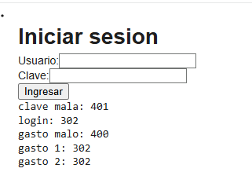
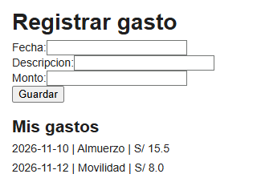
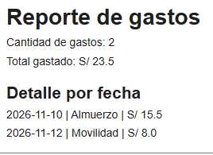

# Control de Gastos
Aplicacion web con Flask, Python y SQLite para registrar gastos y generar reportes.

## Credenciales de acceso
- Usuario: admin
- Clave: 123

## Como funciona
1. Inicias sesion con las credenciales admin / 123 (la clave se guarda con hash en SQLite).
2. En la ruta /gastos registras cada gasto con fecha, descripcion y monto (el servidor valida los datos).
3. En la ruta /reporte ves la cantidad de gastos, el total gastado y el detalle ordenado por fecha.

## Capturas de la aplicacion
### Login

### Registro de gastos

### Reporte

## Ejecucion local
- pip install -r requirements.txt
- python app.py
- Abrir http://127.0.0.1:5000
